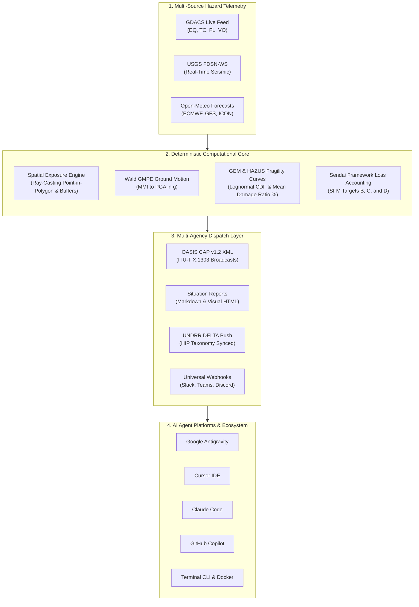

# Disaster Risk Reduction (DRR) Agent Plugin

[](https://agent-plugins.org/)
[](LICENSE)
[]()

A standalone, multi-platform AI Agent Plugin for **Disaster Risk Reduction (DRR) analytics**, built to the [agent-plugins.org](https://agent-plugins.org/) open specification.

This plugin equips AI coding assistants and autonomous agents with domain knowledge skills and deterministic tools for:
* **Multi-Source Hazard Feeds**:
  * **GDACS**: Live and offline UN OCHA / EC DG ECHO alerts for earthquakes, tropical cyclones, floods, and volcanoes.
  * **USGS**: Real-time Earthquake Hazards Program feeds with automated Peak Ground Acceleration (PGA in $g$) estimation from MMI via Wald et al. (1999) ground motion equations.
  * **Open-Meteo**: Global numerical weather forecasts (ECMWF, GFS, ICON) with Anticipatory Action cumulative precipitation thresholds and flood triggers.
* **Deterministic Spatial Exposure Joins**: Ray-casting point-in-polygon and buffer queries intersecting hazard footprints with exposed populations, schools, and hospitals.
* **GEM & HAZUS Physical Fragility Modeling**: Lognormal damage state probability distributions and Mean Damage Ratios (MDR) for earthquakes (PGA), floods (inundation depth), and cyclones (wind speed).
* **Sendai Framework Loss Accounting**: Automatic mapping to Sendai Targets B (affected/displaced population), C (direct economic loss), and D (critical infrastructure disruption).
* **OASIS Common Alerting Protocol (CAP) v1.2**: ITU-T X.1303 compliant XML emergency alert generation and validation, plus multi-agency situation briefs.

---

## Real-World Operations: When & By Whom

For the detailed operational guide, see **[docs/operational-playbook.md](docs/operational-playbook.md)**.

### Target Personas ("By Whom")
* **EOC Duty Officers & Watchstanders** (National Disaster Management Agencies): Rapid situation awareness, triggering public CAP broadcasts, and immediate search-and-rescue prioritization within the first 2 hours of a shock.
* **Anticipatory Action Leads** (Red Cross/Crescent, WFP, Start Network): Verifying forecast-based financing (FbF) triggers 48–72h before a flood or cyclone peaks to release prepositioning funds.
* **UN Humanitarian Affairs Officers** (UN OCHA / UNDAC): Compiling standardized Situation Reports (SitReps) and cluster briefings within the first 6–24 hours of an emergency.
* **National Disaster Loss Focal Points** (UNDRR DELTA): Auditing and mapping post-event losses to UN Sendai Framework Targets (Target B: displacement, C: direct economic loss, D: critical infrastructure damage).
* **Municipal Resilience Engineers** (City Planning / Public Works): Running tabletop earthquake or flood scenarios against local building stock (GEM/HAZUS taxonomy) to prioritize retrofitting.

### Emergency Scenarios ("When")

| Operational Phase | Real-World Scenario | Primary Toolchain | Output / Deliverable |
| :--- | :--- | :--- | :--- |
| **Pre-Disaster**<br>*(T -72h to -24h)* | **Anticipatory Action Flood Early Warning**<br>Atmospheric river or monsoon depression detected. | `drr_openmeteo_forecast` + `drr_spatial_exposure_join` | Trigger verification, shelter standby alerts, pre-disaster evacuation directives. |
| **Co-Disaster**<br>*(T +5m to +2h)* | **Sudden-Onset M7+ Earthquake**<br>Shaking felt across populated provinces. | `drr_usgs_earthquake_fetch` + `drr_fragility_eval` + `drr_cap_alert_generate_validate` | Wald GMPE PGA estimate, structural failure probabilities, OASIS CAP v1.2 XML for cell broadcasts. |
| **Co-Disaster**<br>*(T +6h to +48h)* | **Category 4 Tropical Cyclone Landfall**<br>Catastrophic wind damage along coastal swath. | `drr_gdacs_fetch` + `drr_spatial_exposure_join` + `drr_vulnerability_matrix_calc` | Hospital & bridge damage audit, priority medical deployment list, 24h SitRep brief. |
| **Post-Disaster**<br>*(T +2w to +3m)* | **Sendai Framework Loss Accounting**<br>End-of-year national reporting to UN. | `drr_vulnerability_matrix_calc` + DELTA Resilience DB | Official Sendai Monitor Target B, C, and D loss indicators. |

---

## Executive & Technical Presentation Decks

For stakeholder briefings, executive donor reviews, and emergency operational training:

* **[Interactive Slide Presentation (HTML)](docs/presentation/slides.html)**: Standalone, browser-ready presentation deck with dark/light themes, keyboard navigation (`◀` / `▶` / `Space`), speaker notes drawer (`N`), and fullscreen mode (`F`).
* **[Offline GIS Mapping Presentation (HTML)](docs/presentation/gis-map-presentation.html)**: 100% offline Leaflet-compatible spatial console featuring real-time ray-casting buffer queries, multi-scenario overlays (Nepal EQ, Cyclone Pamela, Bangladesh Flood, Southern Thailand Flood), dynamic GEM/HAZUS damage pins, and Sendai scorecards.
* **[Marp-Compliant Presentation Deck (Markdown)](docs/presentation/drr-agent-plugin-presentation.md)**: 13-slide structured presentation ready to export directly to **PowerPoint (`.pptx`)** or **PDF** via Marp CLI (`npx @marp-team/marp-cli docs/presentation/drr-agent-plugin-presentation.md -o presentation.pptx`) or the VS Code Marp extension.
* **[Featured Use Case: Southern Thailand Flood (Nov 2026)](docs/use-cases/thailand-flood-2026-simulation.md)**: Post-disaster hindcast validation of the 6–7 November 2026 flood across Yala, Songkhla, Pattani, and Narathiwat (Yala 20-year flood event), with point-in-polygon exposure, HAZUS damage math, CAP v1.2 XML alert, visual HTML SitRep, and DELTA push (`make thailand-flood`).
* **[Visual Situation Report (HTML SitRep)](examples/earthquake-hazus-scenario/situation-report.html)**: Printable executive disaster situation report with embedded offline vector GIS map generated directly from deterministic assessment data via `drr-tool sitrep --html` or `make sitrep-sample`.

---

## Architecture & Visual Data Pipeline



### Directory Structure & Layout

```text
drr-agent-plugin/
├── plugin.json                 # agent-plugins.org v1.0.0 manifest (v1.3.0)
├── mcp.json                    # Model Context Protocol stdio server declaration
├── package.json                # Standalone Node package definition
├── Makefile                    # Operational & configuration shortcuts
├── Dockerfile                  # Production Alpine container (~130MB, zero deps)
├── docker-compose.yml          # Autonomous daemon stack & volume persistence
├── docker-entrypoint.sh        # Flexible container entrypoint dispatcher
├── .env.example                # Configuration template
├── alerts-config.example.json  # Declarative early warning threshold rules
├── README.md                   # Master documentation
├── LICENSE                     # Apache 2.0
├── bin/
│   ├── mcp-server.js           # Zero-dependency Node.js MCP server (10 active tools)
│   └── cli.js                  # Direct command-line interface for shell & CI/CD
├── lib/                        # Deterministic computational engines
│   ├── config.js               # Centralized configuration & lightweight .env loader
│   ├── monitor.js              # Autonomous early warning monitoring & webhook dispatcher
│   ├── gdacs.js                # GDACS feed parser & ingestor
│   ├── usgs.js                 # USGS earthquake feed & MMI-to-PGA estimator
│   ├── openmeteo.js            # Open-Meteo precipitation & flood risk engine
│   ├── delta.js                # DELTA Resilience relational draft record writer
│   ├── spatial.js              # Ray-casting point-in-polygon & spatial exposure joins
│   ├── fragility.js            # GEM & HAZUS lognormal fragility curves
│   ├── vulnerability.js        # Vulnerability matrix & Sendai Target B/C/D calculators
│   ├── cap.js                  # OASIS CAP v1.2 XML generator & validator
│   └── utils.js                # Math (erf, normal CDF, haversine distance)
├── skills/                     # Reusable AI Agent Skills (SKILL.md)
│   ├── delta-disaster-recording/
│   ├── early-warning-telemetry/
│   ├── hazard-exposure-modeling/
│   ├── vulnerability-matrix/
│   ├── oasis-cap-alerting/
│   └── gdacs-feed-ingestion/
├── examples/                   # Executable real-world scenarios & fixtures
│   ├── earthquake-hazus-scenario/
│   ├── flood-gdacs-exposure/
│   └── cyclone-emergency-brief/
├── docs/                       # Comprehensive documentation
│   ├── presentation/           # Executive & technical slide decks
│   │   ├── drr-agent-plugin-presentation.md # Marp-compliant deck for PPTX/PDF
│   │   └── slides.html         # Interactive web presentation deck
│   ├── configuration.md        # Environment variables, proxy & settings guide
│   ├── operational-playbook.md # Playbook: When & By Whom to run the plugin
│   ├── api-reference.md        # MCP tool schemas & CLI options
│   ├── methodology.md          # Scientific background & standards
│   └── platforms/              # Per-platform installation guides
│       ├── antigravity.md
│       ├── cursor.md
│       ├── claude-code.md
│       ├── github-copilot.md
│       └── opencode-cli.md
└── tests/                      # Full automated test suite (10 test suites)
    ├── test-config.js
    ├── test-spatial.js
    ├── test-fragility.js
    ├── test-vulnerability.js
    ├── test-cap.js
    ├── test-usgs.js
    ├── test-openmeteo.js
    ├── test-delta.js
    ├── test-monitor.js
    ├── test-mcp-server.js
    └── run-all-tests.sh
```

---

## Quickstart

### Prerequisites
* Node.js $\ge 18.0.0$ (Zero external npm packages required — pure standard library).

### 1. Run All Automated Tests
```bash
bash tests/run-all-tests.sh
```

### 2. Operational & Configuration Shortcuts (Makefile)
The plugin includes a dedicated `Makefile` providing shortcuts for day-to-day operations and configurations:

```bash
# Display help and available commands:
make help

# Initialize configuration files (.env and alerts-config.json):
make config-init

# Validate environment and configuration syntax:
make config-check
make config-show
make alerts-validate

# Run all 10 unit and MCP test suites:
make test

# Launch autonomous early warning monitoring daemon (local or one-shot scan):
make monitor INTERVAL=60
make monitor-once

# Run disaster scenario pipelines:
make scenario-earthquake
make scenario-flood
make scenario-cyclone
make scenarios
```

### 3. Lightweight Docker & Docker Compose Operations
The plugin provides a secure, minimal container image based on `node:22-alpine` (~130MB total footprint, zero external npm dependencies, non-root user):

```bash
# Build the production Docker image:
make docker-build

# Start the autonomous monitoring daemon in the background:
make docker-up

# Check container status and follow logs:
make docker-status
make docker-logs

# Run the 10-suite test suite inside the Alpine container:
make docker-test

# Run a one-shot feed scan inside the container:
make docker-once

# Stop the container:
make docker-down
```

From the root project workspace, you can also run shortcuts directly via `make drr-help`, `make drr-test`, `make drr-monitor`, etc.

### 4. Direct Command-Line Interface (CLI) Usage

For the complete technical flag guide, see **[docs/api-reference.md](docs/api-reference.md)**.

```bash
# ---------------------------------------------------------
# Live Real-Time Telemetry Queries
# ---------------------------------------------------------

# Query live USGS Earthquakes (M5.0+):
node bin/cli.js usgs --min-mag 5.0 --limit 10

# Query live Open-Meteo Anticipatory Action flood triggers:
node bin/cli.js forecast --lat -6.2 --lon 106.8 --days 5

# Query live GDACS disaster alerts (Orange and Red alerts):
node bin/cli.js gdacs --min-level Orange

# ---------------------------------------------------------
# Autonomous Monitoring Engine
# ---------------------------------------------------------

# Run a one-shot scan across all live feeds:
node bin/cli.js monitor --once

# Run the continuous 24/7 monitoring daemon:
node bin/cli.js monitor --interval 60 --config alerts-config.json

# ---------------------------------------------------------
# Two-Way DELTA Resilience Push
# ---------------------------------------------------------

# Push an evaluated assessment directly into DELTA:
node bin/cli.js delta-push \
  --hazard earthquake \
  --event-id "usgs_live_001" \
  --intensity "0.35" \
  --notes "Live USGS Telemetry Event"

# Query DELTA MCP 'docs' tool (data model & workflow reference):
node bin/cli.js delta-docs

# List live UNDRR/ISC HIP hazards directly from DELTA MCP:
node bin/cli.js delta-hazards --limit 20

# ---------------------------------------------------------
# Deterministic Modeling & Alert Generation
# ---------------------------------------------------------

# Calculate earthquake fragility for Unreinforced Masonry (URM) at 0.40g PGA:
node bin/cli.js fragility --hazard earthquake --intensity 0.40 --taxonomy URM

# Run a deterministic spatial exposure join:
node bin/cli.js spatial-join \
  --hazard examples/earthquake-hazus-scenario/input-hazard.json \
  --exposure examples/earthquake-hazus-scenario/input-exposure.json

# Generate an OASIS CAP v1.2 XML alert:
node bin/cli.js cap-generate \
  --headline "EARTHQUAKE WARNING: Mw 7.2 Mainshock" \
  --severity Extreme \
  --urgency Immediate \
  --event "Major Earthquake Emergency Alert"

# Validate a CAP XML file:
node bin/cli.js cap-validate examples/earthquake-hazus-scenario/output-cap-alert.xml
```

---

## MCP Server Tools (11 Tools)

| Tool Name | Description | Source / Methodology |
| :--- | :--- | :--- |
| `drr_gdacs_fetch` | Query active global alerts by severity/type | GDACS GeoJSON API |
| `drr_usgs_earthquake_fetch` | Ingest real-time seismic events & estimate PGA ($g$) | USGS FDSN-WS / Wald et al. GMPE |
| `drr_openmeteo_forecast` | Weather forecast & Anticipatory Action flood triggers | Open-Meteo Multi-Model API |
| `drr_spatial_exposure_join` | Deterministic point-in-polygon spatial exposure join | Ray-casting & BBox algorithms |
| `drr_fragility_eval` | Damage state probabilities & Mean Damage Ratio (MDR) | GEM Taxonomy & HAZUS-MH 2.1 |
| `drr_vulnerability_matrix_calc`| Composite vulnerability & Sendai Targets B, C, D | UNDRR SFM Loss Accounting |
| `drr_cap_alert_generate_validate`| Generate & validate ITU-T X.1303 CAP XML / briefs | OASIS CAP v1.2 Specification |
| `drr_delta_push_draft_record` | Push validated assessment to DELTA as a Draft record | DELTA Resilience API / MCP |
| `drr_delta_fetch_exposure` | Query administrative divisions & exposure from DELTA | DELTA Resilience Data Layer |
| `drr_delta_docs` | Query DELTA MCP 'docs' tool for data model & HIP taxonomy | DELTA MCP Service |
| `drr_monitor_check` | Evaluate active feeds against declarative rules | Autonomous Alert Daemon Engine |

---

## Configuration & Environment Settings

All API endpoints, network proxies, request timeouts, and operational modes are configurable via environment variables or a `.env` file.

* **Configuration Template**: See [`.env.example`](.env.example) to copy and customize.
* **Full Settings Reference**: See **[docs/configuration.md](docs/configuration.md)** for detailed documentation on:
  * **National Country Scoping & DELTA Push Guard**: Restricting automated DELTA ingestion to national borders (`TARGET_COUNTRIES`, `DELTA_COUNTRY`, `bbox`)
  * Overriding GDACS, USGS, and Open-Meteo API endpoints or mirrors
  * Configuring commercial Open-Meteo API keys
  * Setting up `HTTP_PROXY` / `HTTPS_PROXY` for UN / enterprise firewalls
  * Enabling `DRR_OFFLINE_MODE` for air-gapped EOC centers
  * Connecting to core DELTA Resilience via `DELTA_MCP_API_KEY`

---

## Platform Installation Guides

* **[Google Antigravity Guide](docs/platforms/antigravity.md)**
* **[Cursor IDE Guide](docs/platforms/cursor.md)**
* **[Claude Code & Desktop Guide](docs/platforms/claude-code.md)**
* **[GitHub Copilot & VS Code Guide](docs/platforms/github-copilot.md)**
* **[OpenCode & Terminal CLI Guide](docs/platforms/opencode-cli.md)**

---

## Standards Conformance

* **Package Standard**: [Agent Plugins v1.0.0](https://agent-plugins.org/) (`plugin.json`, `mcp.json`, `skills/`).
* **Tool Protocol**: [Model Context Protocol (MCP)](https://modelcontextprotocol.io/) JSON-RPC 2.0 stdio transport (`2024-11-05`).
* **Alerting Standard**: OASIS Common Alerting Protocol v1.2 / ITU-T Recommendation X.1303.
* **Fragility Curves**: GEM Building Taxonomy v2.0 & FEMA HAZUS-MH 2.1 Multi-hazard Loss Methodology.
* **Disaster Loss Reporting**: UN Sendai Framework for Disaster Risk Reduction (2015–2030) Targets A, B, C, and D.
