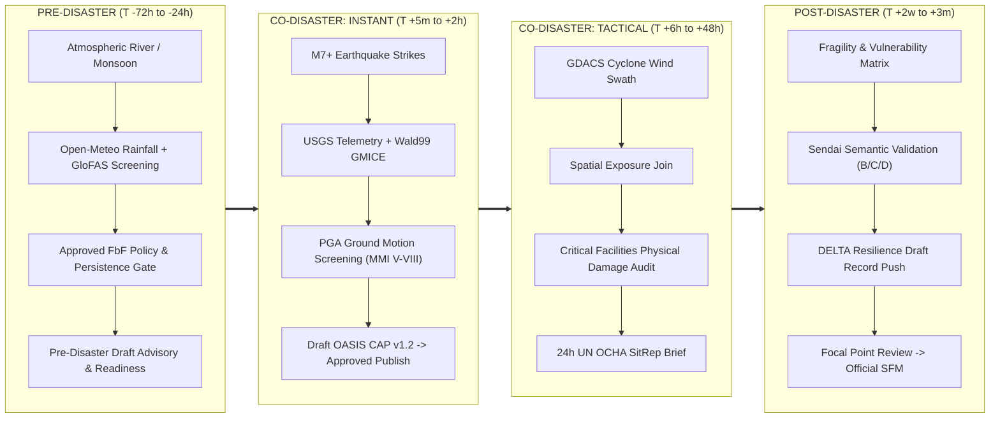

# Operational Playbook: When & By Whom to Run the DRR Agent Plugin

This playbook outlines real-world operational scenarios, emergency management timelines, stakeholder personas, and step-by-step agent workflows across the disaster risk reduction lifecycle.

---

## 1. Stakeholder Personas ("By Whom")

| Persona / Role | Organization / Setting | Primary Purpose for Using the Plugin |
| :--- | :--- | :--- |
| **EOC Duty Officer & Watchstander** | National Disaster Management Agencies (e.g. FEMA, BNPB Indonesia, NDRRMC Philippines, Civil Defense) | Rapid situational awareness, triggering public OASIS CAP sirens/broadcasts, and tactical search-and-rescue prioritization within the first 2 hours of a shock. |
| **Anticipatory Action Lead** | Red Cross / Red Crescent Climate Centre, WFP, Start Network | Verifying forecast-based financing (FbF) triggers 48–72h before a flood or cyclone peaks to release pre-allocated contingency funds. |
| **UN Humanitarian Affairs Officer** | UN OCHA (Office for the Coordination of Humanitarian Affairs) | Synthesizing standardized Situation Reports (SitReps), cluster briefings, and Flash Appeals within the first 6–24 hours of an emergency. |
| **National Disaster Loss Focal Point** | Ministry of Environment / Civil Defense reporting to UNDRR DELTA | Auditing and mapping post-event losses to UN Sendai Framework Targets (Target B: displacement, C: direct economic loss, D: critical infrastructure damage). |
| **Municipal Structural & Resilience Engineer** | City Urban Planning Department / Public Works | Running tabletop earthquake or flood scenarios against the local building stock (GEM/HAZUS taxonomy) to prioritize retrofitting investments. |

---

## 2. Real-World Operational Scenarios ("When")



### Scenario 1: Anticipatory Action Before a Severe Flood (T minus 72h to 24h)
* **Trigger Event**: A multi-model meteorological forecast detects an atmospheric river or monsoon depression.
* **Primary Operator**: Forecast-based Financing (FbF) and Early Warning Coordinators.
* **Relevant Skills**: `forecast-based-action-trigger-design`, `hazard-exposure-modeling`
* **Operational Workflow**:
  1. **Forecast & Discharge Screening**: The operator prompts the agent to run `drr_openmeteo_forecast` (and optionally `drr_basin_rainfall_aggregate` / `drr_river_discharge_screen` for GloFAS $\text{m}^3/\text{s}$ screening) for the vulnerable river basin coordinates.
  2. **Policy & Persistence Gate (C-05)**: The plugin evaluates meteorological thresholds against an explicitly approved `triggerPolicy` and multi-run `previousRuns` persistence. It **never fabricates flood inundation depth from rainfall totals alone** (`depthStatus: "depth_unavailable"`). If depth-based fragility is required, a separately calibrated hydraulic inundation grid is ingested.
  3. **Spatial Intersection**: The agent calls `drr_spatial_exposure_join` with local community flood shelters, water purification plants, and access roads.
  4. **Anticipatory Action**: Once the approved trigger policy and persistence check pass, coordinators release pre-allocated contingency funds and draft `status: "Draft"` public advisories for Duty Officer sign-off.

### Scenario 2: Sudden-Onset M7+ Earthquake (T plus 5 min to 2 hours)
* **Trigger Event**: A major earthquake strikes with ground shaking felt across multiple provinces.
* **Primary Operator**: National Emergency Operations Center (EOC) Watchstanders.
* **Relevant Skills**: `early-warning-telemetry`, `hazard-exposure-modeling`, `oasis-cap-alerting`, `cap-governance-and-approval`
* **Operational Workflow**:
  1. **Hypocenter Query**: The duty officer queries `drr_usgs_earthquake_fetch` to retrieve the revised hypocenter, magnitude, and Instrumental Intensity (MMI).
  2. **PGA Screening via Wald99 GMICE (C-04)**: The plugin converts MMI to **Peak Ground Acceleration ($\text{PGA}$ in $g$)** using the empirical **Wald et al. (1999) GMICE** (not a source-distance GMPE), flagging `extrapolated: true` outside the calibrated MMI V–VIII range:
     $$\text{PGA}_g = \frac{10^{(\text{MMI} + 1.66) / 3.66}}{980.665} \quad (\text{empirical range: } \text{MMI V–VIII})$$
  3. **Illustrative Structural Fragility Assessment (C-06)**: The agent executes `drr_fragility_eval` in `exploratory` mode against local building taxonomies (e.g. non-ductile concrete frame `C1_PRE_CODE` and unreinforced masonry `URM`). Production publication requires locally calibrated curves.
  4. **Draft Warning & Controlled Broadcast (C-07)**: The agent generates a schema-validated **OASIS CAP v1.2 XML** (`drr_cap_alert_generate_validate`, defaulting to `status: "Draft"`) and a command situation brief. Live broadcast requires an authorized Duty Officer cryptographic `approvalToken` via `drr_cap_publish` (with `DRR_ENABLE_PRODUCTION_PUBLISH=true`).

### Scenario 3: Tropical Cyclone Landfall & Immediate Search & Rescue (T plus 6h to 48h)
* **Trigger Event**: A Category 4 tropical cyclone crosses coastlines or island chains.
* **Primary Operator**: UN Disaster Assessment and Coordination (UNDAC) and Civil Defense.
* **Relevant Skills**: `gdacs-feed-ingestion`, `hazard-exposure-modeling`, `vulnerability-matrix`
* **Operational Workflow**:
  1. **Sanitized Footprint Extraction**: The analyst ingests the GDACS cyclone alert (`drr_gdacs_fetch`, checking `promptInjectionFlagged`) and feeds the wind swath into `drr_spatial_exposure_join`.
  2. **Critical Infrastructure Audit**: The tool intersects the footprint with provincial hospitals, power substations, and bridge coordinates.
  3. **Vulnerability Evaluation**: `drr_vulnerability_matrix_calc` calculates facilities with high physical damage probabilities ($\text{MDR} \ge 60\%$), preserving unknown values as `null` and separating physical damage (`D-2`..`D-4`) from service disruption (`D-6`..`D-8`).
  4. **Tactical Deployment**: The agent outputs an operational brief detailing compromised hospitals, directing mobile surgical teams and tactical satellite communications to the most damaged facilities.

### Scenario 4: Annual Sendai Framework Loss Reporting to the UN (Peace Time / Recovery)
* **Trigger Event**: End-of-year national disaster accounting or Post-Disaster Needs Assessment (PDNA).
* **Primary Operator**: UNDRR National Focal Points and Ministry Economists using DELTA Resilience.
* **Relevant Skills**: `sendai-indicator-accounting`, `delta-disaster-recording`, `drr-data-quality-and-provenance`
* **Operational Workflow**:
  1. **Loss Reconciliation & Semantic Validation (C-01..C-03)**: Disaster assessments are audited with `drr_sendai_validate` to ensure:
     * **Sendai Target B**: Modelled shelter displacement (`estimatedDisplaced`) is kept distinct from `B-1` directly affected people (`b1DirectlyAffected: null` unless direct empirical evidence exists), and overlapping sub-populations are not summed without a deduplication methodology.
     * **Sendai Target C**: Direct physical replacement loss records explicit ISO-4217 `currency` and `valuationYear`.
     * **Sendai Target D**: Physical facility damage (`D-2`..`D-4`) is tracked independently from functional service disruption (`D-6`..`D-8`).
     * **Per-100,000 Normalization**: Requires an explicit non-zero `populationDenominator`.
  2. **DELTA Draft Ingestion**: Schema-validated bundles (`drr_delta_schema_validate`) are pushed to DELTA as **Draft records** (`status: "draft"`, `source: "drr-agent-plugin"`) via `drr_delta_push_draft_record` with tenant isolation and preserved C-03 governance metadata, awaiting National Focal Point verification before official submission to the UN Sendai Framework Monitor.

### Scenario 5: Autonomous 24/7 & Scheduled Shadow Early Warning Monitoring
* **Trigger Event**: Continuous automated polling (daemon mode) or scheduled single-run shadow checks (`monitor --once --read-only true`) across global feeds (USGS, GDACS, Open-Meteo).
* **Primary Operator**: EOC Duty System / Infrastructure Sidecar Daemon / GitHub Actions Scheduled Workflow.
* **Relevant Skills**: `event-identity-and-linkage`, `early-warning-telemetry`
* **Operational Workflow**:
  1. **Telemetry Ingestion & Deduplication**: The monitor pulls active seismic events, cyclone wind swaths, and precipitation forecasts, deduplicating across sources (`drr_event_match_deduplicate`) with transactional CAS state checkpoints and lease fencing.
  2. **Declarative Threshold Evaluation**: Checks events against `alerts-config.json` (e.g. Magnitude $\ge 5.5$, estimated PGA $\ge 0.15g$, or rainfall $\ge 200\text{mm}$).
  3. **Automated Impact Modeling**: Runs geodesic spatial exposure joins against local critical facilities GeoJSON and evaluates hazard-appropriate fragility curves.
  4. **Governed Outputs**:
     * **Shadow Mode (`--once --read-only true`)**: Produces audit logs and structured exit codes (`0` success, `2` degraded, `1` failed) without emitting public CAP alerts, webhooks, or DELTA writes.
     * **Active Daemon Mode**: Writes `Draft` OASIS CAP v1.2 XMLs to `alerts/`, dispatches SSRF-hardened webhooks, and submits country-scoped DELTA Draft records when enabled.
* **Execution Commands**:
  ```bash
  # Option 1: Bounded single-run shadow check (read-only by default)
  make monitor-once

  # Option 2: Native Node.js background process via Makefile
  make monitor INTERVAL=60

  # Option 3: Lightweight Alpine Docker daemon (auto-restarting container)
  make docker-up
  make docker-logs

  # Option 4: Direct CLI execution
  node bin/cli.js monitor --interval 60 --config alerts-config.json
  ```

---

## 3. Quick Operator Prompt Cheatsheet

> For complete, per-skill prompt examples across all **13 DRR skills** and multi-skill prompt chains, see **[docs/skills-guide.md](./skills-guide.md)**.

### For EOC Watchstanders (USGS Earthquake & Draft CAP Alert)
* **Agent Prompt**:
  ```text
  Using early-warning-telemetry and oasis-cap-alerting, query USGS for M6.0+ earthquakes (limit 5).
  Extract the Wald99 GMICE estimated PGA (flagging any MMI outside V–VIII), evaluate illustrative
  fragility on URM and C1_PRE_CODE buildings in exploratory mode, and generate a Draft OASIS CAP
  v1.2 XML alert for Duty Officer review.
  ```
* **Direct CLI Equivalent**:
  ```bash
  # Query live earthquakes:
  node bin/cli.js usgs --min-mag 6.0 --limit 5

  # Generate Draft CAP XML alert:
  node bin/cli.js cap-generate --headline "EARTHQUAKE WARNING: Mw 6.8 Mainshock" --severity Extreme --urgency Immediate
  ```

### For Anticipatory Action Leads (Open-Meteo Rainfall & GloFAS Trigger)
* **Agent Prompt**:
  ```text
  Using forecast-based-action-trigger-design, fetch the 5-day precipitation forecast for Dhaka
  (lat 23.8, lon 90.4) via Open-Meteo and check our approved triggerPolicy and persistence rules.
  Confirm that flood depth stays depth_unavailable without a hydraulic model, and intersect our
  critical shelters GeoJSON with the target basin polygon.
  ```
* **Direct CLI Equivalent**:
  ```bash
  node bin/cli.js forecast --lat 23.8 --lon 90.4 --days 5
  ```

### For UN OCHA Officers (GDACS & Situation Brief)
* **Agent Prompt**:
  ```text
  Using gdacs-feed-ingestion, ingest the latest GDACS Orange and Red Tropical Cyclone alerts.
  Verify promptInjectionFlagged status, crosswalk the hazard to UNDRR-ISC HIP, run a spatial join
  against our health clinics and shelter coordinates, and synthesize a 24-hour Emergency Situation
  Brief in Markdown.
  ```
* **Direct CLI Equivalent**:
  ```bash
  node bin/cli.js gdacs --min-level Orange --type TC
  ```

### For National Sendai / DELTA Focal Points (Post-Disaster Audit)
* **Agent Prompt**:
  ```text
  Using sendai-indicator-accounting and delta-disaster-recording, audit
  examples/thailand-flood-scenario/vulnerability-report.json for Sendai Targets B/C/D compliance,
  validate against the DELTA DTS schema, and run a dry-run (mock: true) draft push under tenant THA.
  ```
* **Direct CLI Equivalent**:
  ```bash
  node bin/cli.js sendai-validate --file examples/thailand-flood-scenario/vulnerability-report.json
  node bin/cli.js delta-validate --file examples/thailand-flood-scenario/vulnerability-report.json
  ```
